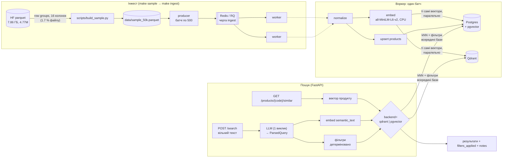

# Similar Products

Пошук схожих продуктів з [Open Food Facts](https://huggingface.co/datasets/openfoodfacts/product-database)
за кодом продукту або текстовим описом («веганське печиво без горіхів з низьким вмістом цукру») з
фільтрами за алергенами, Nutri-Score і веганським статусом. Вектори зберігаються паралельно в Qdrant і
pgvector, щоб чесно порівняти обидві бази на однакових даних.

## Швидкий старт (з нуля)

Потрібні **Docker** (Docker Desktop, пам'ять ≥ 4 ГБ) і **make**. Python на хості не потрібен: усе
працює в контейнерах. Ключ LLM безкоштовний, картка не потрібна: [Google AI Studio](https://aistudio.google.com/apikey)
(Gemini, за замовчуванням) або [Groq](https://console.groq.com/keys). Для kind додатково потрібні `kind`
і `kubectl`.

```bash
git clone <repo> similar-products && cd similar-products
cp .env.example .env        # вписати GEMINI_API_KEY (або LLM_PROVIDER=groq + GROQ_API_KEY)
make up                     # postgres+pgvector, qdrant, redis, api, 2 × worker; чекає, доки API стане healthy
                            # (перший раз до ~10 хв: збірка образу ~2.5 хв + завантаження моделі з HF)
curl localhost:8000/health  # {"status":"ok","postgres":"ok","qdrant":"ok","redis":"ok",...}
make sample                 # 50 000 продуктів з Hugging Face → data/sample_50k.parquet (~1.5 хв, ~130 МБ трафіку)
make ingest                 # черга → воркери → Postgres + ембединги в pgvector і Qdrant (~20 хв), чекає до кінця
```

Після `make ingest` працюють усі [приклади запитів](#приклади-запитів). Swagger доступний на
http://localhost:8000/docs.

- **Зайняті порти** (8000, 5432, 6333/6334, 6379) змінюються в `.env`: `API_PORT`, `POSTGRES_HOST_PORT`,
  `QDRANT_HOST_PORT`, `QDRANT_GRPC_HOST_PORT`, `REDIS_HOST_PORT`.
- **Без ключа LLM** працюють усе, крім `POST /search` (503 `llm_not_configured`). Для офлайн-демо:
  `LLM_PROVIDER=fake`, тоді FakeLLM розбирає кілька відомих фраз.
- **Модель ембедингів** (~90 МБ) завантажується з Hugging Face при першому старті api/worker у volume
  `hf_cache`.
- Ще команди: `make check-stores` (обидві бази тримають ті самі вектори), `make compare` (порівняння
  Qdrant і pgvector), `make down`.

## Архітектура



- **Інжест.** Вибірка стрімиться з HF по row groups (файл не завантажується). Продюсер кладе батчі в
  RQ, а кожен воркер нормалізує рядки, пише їх у Postgres, один раз рахує ембединги й пише ті самі
  вектори паралельно в pgvector і Qdrant.
- **Пошук.** Ранжує завжди векторний kNN, фільтрує завжди база (SQL WHERE / payload-filter). LLM лише
  перетворює текст запиту на фільтри й англійський `semantic_text`: каталогу він не бачить і не вирішує,
  що підходить.
- **Спостережуваність.** OpenTelemetry-спани на кожен крок ([Трейсинг](#трейсинг)).

## Приклади запитів

```bash
curl localhost:8000/health
curl "localhost:8000/products/3700036906990/similar?limit=5"
curl "localhost:8000/products/3700036906990/similar?backend=pgvector&exclude_allergens=nuts,milk&nutriscore_max=c"
curl localhost:8000/search -H 'content-type: application/json' \
  -d '{"query": "веганське печиво без горіхів з низьким вмістом цукру", "limit": 5}'
curl localhost:8000/search -H 'content-type: application/json' \
  -d '{"query": "sausages without pork", "backend": "pgvector", "limit": 5}'
```

Детальніше про кожен ендпоінт — нижче.

### Схожі за кодом продукту

```bash
# 3700036906990 — «Pâte à tartiner 20% de noisettes»
curl "localhost:8000/products/3700036906990/similar?limit=5"                           # backend=qdrant за замовчуванням
curl "localhost:8000/products/3700036906990/similar?backend=pgvector&exclude_allergens=nuts"
curl "localhost:8000/products/3700036906990/similar?exclude_allergens=nuts,milk&vegan_only=true&nutriscore_max=c"
```

Параметри:
- `backend=qdrant|pgvector`;
- `limit` від 1 до 100;
- `exclude_allergens` повторюється або йде через кому. Приймає 14 алергенів ЄС і синоніми (`soy`,
  `peanut`, `dairy`, `sesame`…). Відкидає продукт, якщо алерген є в `allergens_tags` **або**
  `traces_tags`, а також продукт з **невідомим складом** (див. «Припущення»);
- `vegan_only`;
- `nutriscore_max`: найгірша допустима оцінка.

Фільтри застосовуються всередині бази: WHERE з iterative HNSW scan у pgvector, payload-filter у Qdrant.

Відповідь містить `product`, `backend`, `filters_applied` (нормалізовані: `["en:nuts"]`), `took_ms`
(лише векторний пошук) і `results` зі `score` та полями-фільтрами. Помилки мають одну форму
`{"error": {"code", "message", "details"?}}`: 404 `product_not_found`, 409 `not_indexed`,
422 `invalid_request`.

### Текстовий запит

```bash
curl localhost:8000/search -H 'content-type: application/json' \
  -d '{"query": "веганське печиво без горіхів з низьким вмістом цукру", "backend": "qdrant", "limit": 5}'
```

Як це працює:
1. **Один виклик LLM** ([app/llm/parse_query.py](app/llm/parse_query.py); Gemini, Groq або FakeLLM)
   перетворює текст на `ParsedQuery`: `semantic_text` (англійською, лише тип продукту),
   `exclude_allergens`, `vegan_required`, `nutriscore_max`, `sugar_level`, `unsupported`. Якщо JSON
   невалідний, буде один retry. Після двох невдач — 502 `llm_bad_response`, а не здогадка.
2. **Детерміновано в коді** ([app/schemas.py](app/schemas.py) `ParsedQuery.to_filters`):
   - назви алергенів стають тегами OFF;
   - `sugar_level=low` стає `sugars_100g ≤ 5`;
   - усе, що не вдалося виразити фільтром, потрапляє в `notes`.
3. `semantic_text` кодується в ембединг, далі йде векторний пошук з фільтрами всередині бази, як у GET.

**LLM ніколи не бачить каталог і не вирішує, що підходить.** Відповідь показує, як LLM прочитав запит
(`parsed`), що база реально відфільтрувала (`filters_applied`) і чого застосувати не вдалося (`notes`).

Приклад (Gemini, 50k продуктів, qdrant):

```
parsed:  {"semantic_text": "cookie biscuit", "exclude_allergens": ["nuts", "peanuts"], "vegan_required": true,
          "nutriscore_max": null, "sugar_level": "low", "unsupported": []}
filters: {"exclude_allergens": ["en:nuts", "en:peanuts"], "vegan_only": true, "sugars_max": 5.0}
  0.503 Mon Petit Panda Carotte Citrouille  vegan=yes sugar=2.7  (biscuits salés)
  0.432 Chips de panisse 80 grammes         vegan=yes sugar=1.5  (crackers)
  0.417 Back Oblaten (70mm)                 vegan=yes sugar=2.0  (biscuits)
  0.416 Hint Of Salt                        vegan=yes sugar=0.0  (crackers)
  0.413 Waffeln aus Hirse                   vegan=yes sugar=0.7  (waffles)
```

У вибірці 50k взагалі мало продуктів, що проходять усі три фільтри і є печивом, тому нижче в списку
йдуть сусідні категорії. Запит «sausages without pork» повертає ковбаски з поміткою
`notes: ["not filtered (no such filter): 'without pork'"]`.

## Порівняння Qdrant vs pgvector

Той самий набір запитів на тій самій вибірці й тих самих векторах: 10 продуктів за їхнім вектором і
10 текстових запитів, без фільтрів і з вибірковим фільтром. recall@10 рахується відносно точного
косинуса в numpy. Відтворюється командою `make compare`, повний звіт з умовами й recall по кожному
запиту — у [eval/comparison_report.md](eval/comparison_report.md).

<!-- comparison:start -->
Умови: 50000 векторів × 384, cosine; HNSW в обох `m=16`, `ef_construct=64`, пошук `ef=100`; Qdrant: 50000 точок, indexed_vectors_count=51000 (лічильник Qdrant: менше за точки — малий сегмент шукається перебором, більше — після перезапису ще не прибрані старі версії); 20 запитів × 20 прогонів після 3 прогрівних; aarch64, Linux (Docker), seed 0. Селективність: «no filters» проходить 100.0% продуктів; «vegan, no nuts, sugar <= 5 g» проходить 5.3% продуктів.

| Сценарій | Backend | p50, мс | p95, мс | recall@10 (середній) | recall@10 (мін.) |
| --- | --- | ---: | ---: | ---: | ---: |
| no filters | qdrant (gRPC) | 6.43 | 8.10 | 0.980 | 0.8 |
| no filters | qdrant (HTTP) | 47.16 | 49.31 | 0.980 | 0.8 |
| no filters | pgvector | 3.36 | 5.21 | 0.985 | 0.8 |
| vegan, no nuts, sugar <= 5 g | qdrant (gRPC) | 2.96 | 4.19 | 1.000 | 1.0 |
| vegan, no nuts, sugar <= 5 g | qdrant (HTTP) | 43.80 | 45.08 | 1.000 | 1.0 |
| vegan, no nuts, sugar <= 5 g | pgvector | 9.73 | 34.33 | 0.925 | 0.7 |
<!-- comparison:end -->

Висновки:
- **Без фільтрів якість однакова:** recall@10 0.98–0.985, промахи здебільшого на тих самих запитах,
  тобто це межа HNSW з цими параметрами, а не різниця реалізацій. За швидкістю на свіжій колекції
  бази були рівні (p50 3.6 мс у Qdrant проти 3.7 мс у pgvector, прогін KAN-61). Після повного
  повторного інжесту (у таблиці вище) Qdrant без фільтра повільніший: ~6.4 мс. У ньому лишилося ~4 %
  старих версій точок (`indexed_vectors_count` 52 024 при 50 000 точок), які вакуум не прибирає, бо
  його поріг — 20 %. Чи в цьому причина, не доведено.
- **З вибірковим фільтром Qdrant кращий і за якістю, і за швидкістю:** recall@10 1.000 проти ~0.93,
  p95 ~4 мс проти ~30 мс. Qdrant планує фільтрований пошук за payload-індексами:
  на малій відфільтрованій множині він, імовірно, рахує точно. pgvector іде по HNSW-графу й
  відкидає кандидатів фільтром (iterative scan), тож на рідкісних фільтрах губить сусідів і довше
  ходить графом. Поліпшити pgvector можна більшим `hnsw.ef_search` або частковими індексами під
  часті фільтри, але це вже тюнінг під конкретні запити.
- **Транспорт важить більше, ніж база:** REST-клієнт Qdrant (httpx) додає сталі ~40 мс на запит.
  Тому API ходить у Qdrant по gRPC.
- **Відтворюваність:** повторний `make compare` дає той самий recall по кожному запиту (пошук
  детермінований), а латентність відрізняється в межах ~1 мс.

## Трейсинг

OpenTelemetry ([app/telemetry.py](app/telemetry.py)) у API (`FastAPIInstrumentor`: серверний спан на
кожен запит, крім `/health`) і у воркері. Кастомні спани:

| Де | Спани |
| --- | --- |
| `POST /search` | `llm_parse` (провайдер, спроби, `semantic_text`) → `embed_query` → `vector_search` (backend, фільтри, hits) → `fetch_products` |
| `GET /products/{code}/similar` | `get_vector` → `vector_search` → `fetch_products` |
| воркер, `ingest_batch` | `normalize` → `load_embedder` → `embed` → `upsert_products` → `write_pgvector` ‖ `write_qdrant` (паралельно) |

**За замовчуванням — консоль** (`TRACING_EXPORTER=tree`): коли запит чи джоб завершується, його дерево
спанів друкується в лог, один рядок на спан:

```bash
docker compose logs -f api      # або worker
```
```
── trace 760808583d538018f3b8e85507ce4202 ──────────────────────────────
POST /search                                1244.9 ms
  llm_parse                                  813.7 ms  llm.provider=gemini query.chars=52 llm.attempts=1 parsed.semantic_text=cookie biscuit
  embed_query                                414.9 ms  text=cookie biscuit
  vector_search                               11.3 ms  backend=qdrant limit=5 filters={"exclude_allergens":["en:nuts","en:peanuts"],"vegan_only":true,"sugars_max":5.0} hits=5
  fetch_products                               2.2 ms  rows=5
```

Інші значення `TRACING_EXPORTER`: `console` (сирий JSON на кожен спан від `ConsoleSpanExporter`),
`none` (трейсинг вимкнено).

**Jaeger (опційно):**

```bash
TRACING_EXPORTER=otlp docker compose --profile observability up -d   # або TRACING_EXPORTER=otlp у .env
open http://localhost:16686                                           # сервіси similar-products-api / -worker
```

API і воркер шлють спани по OTLP/HTTP на `jaeger:4318`. Повернутися до консолі: `docker compose up -d`
без змінної, а Jaeger зупиняється командою `docker compose --profile observability stop jaeger`.

## Kubernetes (kind)

Той самий стек у локальному kind-кластері, без хмари. Маніфести лежать у [k8s/](k8s/), конфіг кластера —
у [kind-config.yaml](kind-config.yaml).

```bash
make kind-up     # = kind create cluster --config kind-config.yaml
                 #   docker build -t similar-products:dev . && kind load docker-image similar-products:dev
                 #   kubectl apply -f k8s/ && kubectl rollout status ...   (~3 хв на чистому кластері)
kubectl -n similar-products port-forward svc/api 8000:8000
curl localhost:8000/health
```

Без `port-forward` API доступний на `localhost:8800` (NodePort 30800 через port-mapping kind).
Прибрати все: `make kind-down`.

- **Що піднімається** (namespace `similar-products`): `postgres` і `qdrant` (StatefulSet + PVC по 2 Gi),
  `redis`, `api`, `worker` × 2. Налаштування лежать у ConfigMap `app-config`, пароль БД — у Secret
  `postgres`.
- **Ключі LLM у репозиторії немає.** Їх бере необов'язковий Secret `llm-keys`, без нього `/search`
  відповідає 503 `llm_not_configured`, а решта працює:
  ```bash
  kubectl -n similar-products create secret generic llm-keys \
    --from-env-file=<(grep -E '^(GEMINI|GROQ)_API_KEY=' .env)
  kubectl -n similar-products rollout restart deployment/api
  ```
- **Дані:** кластер стартує з порожніми базами. Швидкий смоук (fixture, 326 рядків, ~1 хв):
  ```bash
  kubectl -n similar-products exec deploy/api -- python -m app.ingest.producer --source tests/fixtures/sample_products.parquet
  ```
  Повна вибірка (~20 хв):
  ```bash
  POD=$(kubectl -n similar-products get pod -l app=api -o jsonpath='{.items[0].metadata.name}')
  kubectl -n similar-products cp data/sample_50k.parquet $POD:/tmp/sample_50k.parquet
  kubectl -n similar-products exec $POD -- python -m app.ingest.producer --source /tmp/sample_50k.parquet
  ```
- **Порядок старту:** init-контейнер `wait-for-deps` ([scripts/wait_for.py](scripts/wait_for.py)) чекає
  на postgres, qdrant і redis. Без нього api та воркери падали на старті й перезапускалися 2–4 рази.
- **Проби API:** `readinessProbe` дивиться `/health` (под виходить із Service, поки якась база
  лежить), а `livenessProbe` — лише TCP, щоб падіння бази не перезапускало API. `startupProbe` дає до
  5 хв на завантаження моделі.

## Як це влаштовано

### Інжест

Продюсер ([app/ingest/producer.py](app/ingest/producer.py)) застосовує міграції, кладе вибірку в RQ-чергу
`ingest` батчами по 500 рядків і стежить за прогресом (скільки джобів зроблено, скільки в черзі, скільки
рядків записано). Воркери (`rq worker ingest`, сервіс `worker`, 2 репліки;
[app/ingest/worker.py](app/ingest/worker.py)) нормалізують сирі рядки й роблять upsert у `products` за `code`.
Потім рахують ембединги батчем ([app/embeddings.py](app/embeddings.py), `all-MiniLM-L6-v2`, CPU) і пишуть
**ті самі вектори паралельно** в pgvector (`products.embedding`) і в Qdrant (колекція `products`, cosine,
HNSW `m=16`, `ef_construct=64` — як у pgvector; payload — поля-фільтри з індексами).
[app/vectorstores/](app/vectorstores/)

- **Ідемпотентність:** `INSERT ... ON CONFLICT (code) DO UPDATE`. Повторний `make ingest` лишає 50 000
  рядків, лише оновлює `updated_at`.
- **Помилки:** кривий рядок не валить батч, а рахується як `invalid`. Помилка БД валить батч, і RQ
  повторює його (3 спроби: через 5, 30 і 60 с). Після цього батч іде у failed registry, а продюсер
  виходить з кодом 1.
- **Убитий воркер не блокує чергу.** Під час розробки перезапуск воркерів посеред батча лишив у Postgres
  відкриту транзакцію від мертвого клієнта, і наступний джоб на тих самих рядках чекав на блокування.
  Тепер воркер має `stop_grace_period: 2m`, тож поточний батч встигає дописатися. Postgres має
  TCP keepalive 60/10/3, тож мертві з'єднання відрізаються за ~90 с. З'єднання мають
  `lock_timeout=60s`: джоб падає, і RQ його повторює.
- **Замір 2026-09-30:** без ембедингів 50 000 рядків, 100 джобів, 2 воркери — **13 с**. З ембедингами —
  ~20 хв. На батч з 500 рядків кодування займає ~20 с, запис у pgvector ~1.3 с, у Qdrant ~0.3 с (це
  видно в логах воркера, `batch done`). CPU-torch у Linux-VM Docker на Mac кодує ~25 текстів/с на
  воркер, а нативно на macOS — 177/с.


### Дані

`openfoodfacts/product-database` (HF, `food.parquet`: 7.86 ГБ, 4.77M рядків, 145 колонок, ~4.7k row groups
по ~1k рядків, відсортовано за штрихкодом). Файл ніколи не завантажується цілком:

```bash
make sample    # → data/sample_50k.parquet (не комітиться)
make fixture   # → tests/fixtures/sample_products.parquet (комітиться, для офлайн-тестів)
```

Замір 2026-09-30: 50 000 корисних рядків з 125 593 прочитаних за **92 с**, завантажено **130.5 МБ = 1.7 %**
файлу (з них ~104 МБ — футер parquet з метаданими, решта — лише 16 потрібних колонок по ~0.2 МБ на row
group). Читач — [app/ingest/source.py](app/ingest/source.py).

Реальна схема відрізняється від картки датасету: `product_name` і `ingredients_text` — списки
`{lang, text}`, `nutriments` — список `{name, 100g, ...}`, веганський статус — у `ingredients_analysis_tags`.
Нормалізований запис — `Product` у [app/ingest/source.py](app/ingest/source.py).

Fixture (326 рядків) покриває кожен випадок з `CASES` у [scripts/build_fixture.py](scripts/build_fixture.py):
vegan yes/no/maybe/unknown, Nutri-Score a–e і невідомий, цукор низький/високий/невідомий, алергени (горіхи,
арахіс, молоко, глютен, яйця, соя), лише сліди горіхів, печиво, у т.ч. приклад із задачі.

#### Схема Postgres

`products` ([migrations/](migrations/)): поля-фільтри (`allergens_tags`, `traces_tags`, `categories_tags`,
`vegan`, `nutriscore_grade`, `sugars_100g`, …) і `embedding vector(384)`. Індекси:

- `products_embedding_hnsw` — HNSW, `vector_cosine_ops`, `m=16`, `ef_construction=64` (дефолти pgvector);
- GIN на `allergens_tags`, `traces_tags`, `categories_tags`.

`EXPLAIN ANALYZE` на копії 50 000 продуктів з випадковими векторами (pgvector 0.8.6):

| Запит | План | Час |
| --- | --- | --- |
| `ORDER BY embedding <=> $1 LIMIT 10` | `Index Scan using products_embedding_hnsw` | 1.7 мс |
| те саме + `vegan='yes' AND NOT allergens_tags && '{en:nuts,en:peanuts}' AND sugars_100g <= 5`, `hnsw.iterative_scan = relaxed_order` | `Index Scan using products_embedding_hnsw` + Filter, 10 з 10 рядків | 7.7 мс |
| `categories_tags && '{en:biscuits}'` | `Bitmap Index Scan on products_categories_gin` | 6.8 мс |

## Тести

```bash
make test           # усі тести в контейнері: unit + integration (integration потребує `make up`)
make test-offline   # unit-набір у контейнері з --network none і без .env: доказ, що мережа й ключі не потрібні
uv run pytest -m "not integration"   # те саме на хості (потрібен uv)
make lint           # ruff check + ruff format --check
```

- **Офлайн-набір (`-m "not integration"`, 79 тестів):**
  - нормалізація записів OFF на реальній схемі стріму;
  - розбір запиту з `FakeLLM` (приклад із задачі, retry невалідного JSON, 502 після двох невдач,
    умови без фільтра → `notes`);
  - семантика кожного фільтра на Qdrant у пам'яті (`QdrantClient(":memory:")`) над
    fixture-вибіркою (326 продуктів);
  - наскрізний `POST /search` без бази й мережі;
  - черга RQ на fakeredis;
  - трейси;
  - стійкість: повтор після тимчасової помилки Qdrant, 503 замість 500, коли падає сховище чи БД,
    продюсер переживає збої Redis.

  Ембединги в тестах фейкові (хешований bag-of-words): модель не завантажується.
- **Integration (`-m integration`, 35 тестів):** ті самі контракти на справжньому Postgres + pgvector у
  тимчасовій схемі, яка видаляється після тесту, а також міграції, використання індексів і API-тести.
  Маркер ставиться автоматично (`tests/conftest.py`), а без запущеного Postgres ці тести пропускаються.

## Фінальна репетиція

**Запуск з нуля лише за README** (2026-09-30). Копія репозиторію без `data/` і `.env`, окремий
compose-проєкт з чистими volumes і кешем моделі, `.env` з `.env.example` + ключ Gemini. Команди
«Швидкого старту» підряд:

| Крок | Результат |
| --- | --- |
| `make up` | 5 хв 44 с (з завантаженням моделі), сам дочекався `/health` = 200 |
| `make sample` | 50 000 з 125 593 рядків, 130.5 МБ (1.7 % файлу), та сама вибірка, що й раніше (seed 0) |
| `make ingest` | 18 хв 38 с, 100/100 джобів, `products` = 50 000 |
| приклади з README | усі 5 працюють |
| `make check-stores` | Qdrant 50 000 = pgvector 50 000, вектори ідентичні, перетин top-10 0.98 |

Перша спроба на перевантаженій машині (поруч працювали основний стек і kind) знайшла чотири проблеми, і
всі вони виправлені:
- `curl /health` одразу після `make up` падав, поки API вантажив модель. Тепер `make up` сам чекає,
  доки API стане healthy.
- Одна пауза Redis «вбивала» `make ingest`, хоча воркери працювали далі. Тепер продюсер повторює
  опитування.
- Після ~35 хв простою gRPC-канал до Qdrant «напівмертвів», і пошук висів 30 с, а потім давав 500.
  Тепер є keepalive, дедлайн 5 с з одним повтором і 503 `backend_unavailable`.
- Postgres перезапустив бекенди (crash recovery), пул віддав мертве з'єднання, і це давало 500. Тепер
  пул перевіряє з'єднання, а відмова БД стає 503 `database_unavailable`.

**Нові запити** (не з тестів, прикладів чи промпту), Gemini, обидва бекенди дали **однакові** top-5:

| Запит | Як прочитав LLM | Результат |
| --- | --- | --- |
| «безглютенові макарони з нутрі-скором A або B» | `pasta noodles`, без `gluten`, Nutri-Score ≤ b | рисова локшина, удон, паста; усі a/b ✔, але удон пшеничний: у нього немає ні тегу глютену, ні складу |
| «несолодкий грецький йогурт» | `greek yogurt yoghurt`, цукор ≤ 5 г | 5 грецьких йогуртів, цукор 2.3–4.8 г ✔ |
| «протеїновий батончик без арахісу та сої» | `protein bar snack`, без `peanuts`, `soybeans` | протеїнові й горіхові батончики без цих тегів ✔ |
| «органічний хумус без кунжуту» | `hummus dip spread`, без `sesame-seeds`; «органічний» → `notes` | 5 хумусів ✔ за тегами, але хумус зазвичай містить тахіні: у цих продуктів немає ні алергенів, ні складу |

Розбір запитів і фільтри спрацювали правильно в усіх чотирьох випадках. Слабке місце — **дані**:
порожні `allergens_tags` в OFF часто означають «невідомо», а не «немає». Після репетиції фільтр
алергенів відкидає продукти з невідомим складом (див. «Припущення»).

**Після змін** (ті самі запити, повторний інжест):
- **Хумус «без кунжуту»:** зникли хумуси з невідомим складом. У топі лишилися «Hummus Original» і
  «Hummus Naturel», у складі яких є `SESAME paste` / `sesam pasta`, але OFF не проставив тег
  `en:sesame-seeds`.
- **Макарони «без глютену»:** зник удон без складу, але лишилася «Whole Wheat Noodles» (пшениця) без
  тегу глютену.
- **Йогурт і батончики:** без змін, коректно. Позначки «горіхи» в батончиках законні: просили без
  арахісу й сої.
- **Варіативність LLM:** у цьому прогоні LLM двічі сформулював `semantic_text` по-різному («hummus dip
  spread» / «hummus dip»), тому топи бекендів трохи відрізняються. З однаковим `semantic_text` вони
  збігаються.

**Висновок репетиції:** розбір запиту, фільтри й обидва бекенди поводяться правильно й детерміновано.
Головний ризик для алергіків — **повнота тегів алергенів у OFF**. Невідомий склад фільтр уже
відкидає, але пропущені теги при відомому складі (кунжут у тахіні, пшениця в локшині, 228 горіхових
продуктів) лишаються. Наступний крок — звіряти фільтр ще й зі складом: таксономія `ingredients_tags`
(`en:tahini` → `en:sesame`) або багатомовні ключові слова в `ingredients_text`.

## Структура

```
app/            FastAPI (main.py, config.py, health.py), db.py (міграції, upsert), telemetry.py (трейси),
                embeddings.py (модель і FakeEmbedder), errors.py (формат помилок)
migrations/     SQL-схема, ідемпотентна, застосовується на старті
app/api/        роутери пошуку (search.py: GET /products/{code}/similar)
app/schemas.py  фільтри пошуку, ParsedQuery, форми відповідей
app/ingest/     стрім HF, черга Redis/RQ, воркери
app/vectorstores/  Qdrant і pgvector за спільним інтерфейсом
app/llm/        LLMClient і провайдери (gemini | groq | fake)
eval/           порівняння Qdrant vs pgvector
scripts/        build_sample.py (HF → data/), build_fixture.py (→ tests/fixtures/), check_stores.py,
                wait_for.py (init-контейнери k8s)
data/           локальна вибірка, не комітиться
k8s/            маніфести для kind (kind-config.yaml у корені; make kind-up / kind-down)
tests/          unit (офлайн) та integration (маркер ставиться автоматично, див. «Тести»);
                налаштування pytest — у pyproject.toml
```

## Припущення

Кожне — з посиланням на файл, де воно закладене.

- **Читання без `datasets`.** `load_dataset(..., streaming=True)` за 20 хв не віддав навіть 5k рядків
  (тягне всі 145 колонок дрібними запитами). Тому pyarrow через `HfFileSystem` читає окремі row groups і
  лише потрібні колонки, паралельно у 8 потоків. Це теж стрімінг, без повного завантаження.
  [app/ingest/source.py](app/ingest/source.py)
- **Вибірка — випадкові row groups (seed 0), а не перші N.** Файл відсортований за штрихкодом, тож перші
  50k — один вузький діапазон кодів. Випадкові групи дають зріз усієї бази, і він відтворюваний.
  [app/ingest/source.py](app/ingest/source.py)
- **У вибірку йдуть лише корисні для пошуку рядки:** є штрихкод і назва, продукт не `obsolete`, і є хоча б
  категорії або склад. Під ці умови підпадає ~40 % рядків. [app/ingest/source.py](app/ingest/source.py) (`normalize`)
- **Мова тексту:** англійська, якщо є, інакше мова продукту, інакше `main`. Англійська назва є лише у
  ~37 % вибірки, найчастіші мови — fr 37 %, en 31 %, de 9 % (як з цим живе модель ембедингів — нижче). [app/ingest/source.py](app/ingest/source.py) (`pick_text`)
- **Невідоме — це `None`/`unknown`, а не «ні»:** Nutri-Score `unknown`/`not-applicable`, цукор поза 0–100 г,
  відсутній веганський тег. [app/ingest/source.py](app/ingest/source.py)
- **Redis + RQ, а не Celery.** Черга тут одна (інжест), задача одна (батч рядків), розклад і
  ланцюжки задач не потрібні. RQ — це один процес `rq worker` поверх Redis: без брокера AMQP, без
  конфігурації воркерів, з вбудованими retry і failed registry, яких достатньо. Celery дав би більше
  можливостей (маршрутизація, beat, canvas), але це більше рухомих частин без жодного виграшу для одного
  батч-інжесту. Redis і так піднімається в Docker без реєстрацій. [app/ingest/](app/ingest/)
- **Батчі по 500 рядків, а не джоб на рядок.** RQ форкає процес на кожен джоб, тож 50k однорядкових
  джобів переважно форкалися б. Джоб несе сирі рядки, а нормалізація відбувається у воркері, щоб правила
  жили в одному місці. [app/ingest/producer.py](app/ingest/producer.py)
- **Міграції** (`migrations/*.sql`, ідемпотентні) застосовують API на старті і продюсер перед
  інжестом. Advisory lock не дає їм гонитися. [app/db.py](app/db.py)
- **Колонка `vegan`, а не `vegan_status`** (як у тексті задачі): назва вже була в `Product` з KAN-55,
  а значення ті самі (`yes`/`no`/`maybe`/`unknown`). [migrations/001_products.sql](migrations/001_products.sql)
- **Вектор і індекси — окрема міграція `002`**, а не правка `001`. `001` вже застосована на заповненій
  базі, і `CREATE TABLE IF NOT EXISTS` не додав би в неї колонку.
  [migrations/002_pgvector.sql](migrations/002_pgvector.sql)
- **Фільтрований kNN у pgvector — через `hnsw.iterative_scan = relaxed_order`.** Без нього HNSW віддає
  лише `ef_search` (40) кандидатів до фільтра, і рідкісний фільтр повертав би менше 10 результатів.
- **Модель ембедингів — `all-MiniLM-L6-v2`, як у задачі.** Порівнював на 5k продуктів, 5 запитів,
  P@10 за очікуваною категорією: англійські запити 0.66 проти 0.56 у
  `paraphrase-multilingual-MiniLM-L12-v2`, до того ж вона швидша. Українські запити погано тягнуть
  обидві (0.04 / 0.24), тому парсер запиту (KAN-60) передає в ембединг англійський текст. Продукти
  добре кодуються англійською навіть французькі, бо теги категорій OFF англійські. Модель задається
  в `EMBEDDING_MODEL`. [app/embeddings.py](app/embeddings.py)
- **Текст для ембедингу:** назва, потім категорії без мовного префікса («hazelnut spreads»), потім
  склад. Медіана — 48 токенів, 4 % текстів обрізаються на 256.
- **Id у Qdrant — UUIDv5 від `code`**: Qdrant приймає лише uint або UUID, а штрихкоди мають провідні
  нулі. `code` лежить у payload. [app/vectorstores/qdrant_store.py](app/vectorstores/qdrant_store.py)
- **Воркер — `SimpleWorker`** (без fork на кожен джоб): модель вантажиться раз на воркер, і torch не
  переживає fork. Модель завантажується з HF при першому запуску в volume `hf_cache`.
- **Обидві бази пишуться в одному джобі.** Якщо запис в одну з них падає, падає весь батч, і RQ його
  повторює. Усі записи — upsert, тож бази не розходяться назавжди.
- **Невідоме не проходить фільтр:**
  - `vegan_only` пропускає лише `yes` (не `maybe` і не `unknown`);
  - `nutriscore_max` відкидає продукти без оцінки;
  - `sugars_max` відкидає продукти з невідомим цукром;
  - `exclude_allergens` відкидає продукти без складу (`ingredients_text`): у OFF порожні теги алергенів
    у такого продукту означають «ніхто не вніс», а не «немає». Рішення ухвалене на фінальній
    репетиції, де «хумус без кунжуту» повертав хумуси з невідомим складом, хоча хумус зазвичай містить
    тахіні. Ціна: запити з алергенами бачать ~55 % каталогу (склад невідомий у 45.1 % вибірки). Плейсхолдер
    `"undefined"`, який деякі застосунки OFF пишуть замість складу (1009 продуктів), теж вважається
    невідомим складом ([app/ingest/source.py](app/ingest/source.py) `_clean`).

  [app/schemas.py](app/schemas.py), `ingredients_known` у payload Qdrant
- **Горіхи = `en:nuts` (деревні), арахіс окремо (`en:peanuts`)**, як у регламенті ЄС 1169/2011.
  «Без горіхів» з арахісом — це `exclude_allergens=nuts,peanuts`. [app/schemas.py](app/schemas.py)
- **Теги алергенів OFF неповні, і це лишається обмеженням.** Із 2910 продуктів вибірки, у назві чи
  складі яких згадано фундук, мигдаль, волоський горіх, кеш'ю тощо, у 729 (25 %) немає `en:nuts` ні в
  алергенах, ні в слідах. Правило «невідомий склад не проходить» прибирає 501 із них. 228 лишаються:
  склад відомий і згадує горіхи, але тег не проставлено. Наступний крок — перевіряти ще й таксономію
  складу OFF (`ingredients_tags`: `en:hazelnut` → `en:tree-nut`). Для цього потрібна нова колонка у
  вибірці та повторний інжест.
- **LLM лише парсить запит.** `semantic_text` — тип продукту англійською з синонімами, без обмежень:
  у ембедингу «vegan» піднімав будь-що з «Vegan» у назві (соус, чипси, протеїн), а «without nuts»
  притягував би горіхи. Перевірено на живому Gemini: з «vegan cookies» у топі були Vegan Mayo і
  протеїн, з «cookie biscuit» — печиво й крекери. [app/llm/parse_query.py](app/llm/parse_query.py)
- **«Низький цукор» ≤ 5 г/100 г** (claim ЄС для твердих продуктів; 2.5 г/100 мл для напоїв не
  застосовується, бо OFF не розрізняє їх надійно). Невідомий цукор фільтр не проходить.
  [app/schemas.py](app/schemas.py) (`LOW_SUGAR_MAX_G`)
- **`vegan_required: false` = без фільтра** (просити «не веганське» ніхто не буде).
- **Умови без відповідного фільтра не губляться.** LLM перелічує їх в `unsupported` («without
  pork», «organic», «до 3 євро»), і вони потрапляють у `notes`.
- **LLM іноді розширює «без горіхів» до горіхів і арахісу.** Для алергіків це безпечніше, тож не
  виправляється.
- **Стійкість до збоїв сховищ** (знайдено на фінальній репетиції, де машина була перевантажена):
  - gRPC-канал до Qdrant має keepalive, бо після ~35 хв простою з'єднання «напівмертвіло» і пошук
    висів 30 с;
  - пошукові читання мають дедлайн 5 с і один повтор;
  - пул Postgres перевіряє з'єднання, перш ніж видати його;
  - будь-яка відмова бази стає 503 (`backend_unavailable` / `database_unavailable`), а не 500;
  - продюсер переживає тимчасові збої Redis під час моніторингу.

  [app/vectorstores/](app/vectorstores/), [app/errors.py](app/errors.py), [app/ingest/producer.py](app/ingest/producer.py)
- **Qdrant через gRPC** (`QDRANT_PREFER_GRPC=true`, порт 6334). REST-клієнт додавав ~40 мс на
  кожен пошук (eval/comparison_report.md). [app/vectorstores/__init__.py](app/vectorstores/__init__.py)
- **Власна телеметрія FastAPI вимкнена** (`telemetry={...: False}`). FastAPI 0.142 сам додає
  OTLP-експортер, щойно бачить `OTEL_EXPORTER_OTLP_ENDPOINT`, навіть коли `TRACING_EXPORTER=tree`.
  Трейсинг іде лише через [app/telemetry.py](app/telemetry.py) та `opentelemetry-instrumentation-fastapi`.
- **Однаковий `ef` пошуку в обох базах** — `SEARCH_EF = 100` (pgvector `hnsw.ef_search`, Qdrant
  `hnsw_ef`). [app/vectorstores/base.py](app/vectorstores/base.py)
- **Орієнтири для цукру у fixture:** «низький» ≤ 5 г/100 г (той самий поріг, що й у пошуку), «високий»
  > 22.5 г/100 г (UK FSA). У вибірці 50k лише 3 веганських печива без горіхів з цукром ≤ 5 г, і 54
  веганських печива загалом. [scripts/build_fixture.py](scripts/build_fixture.py)
